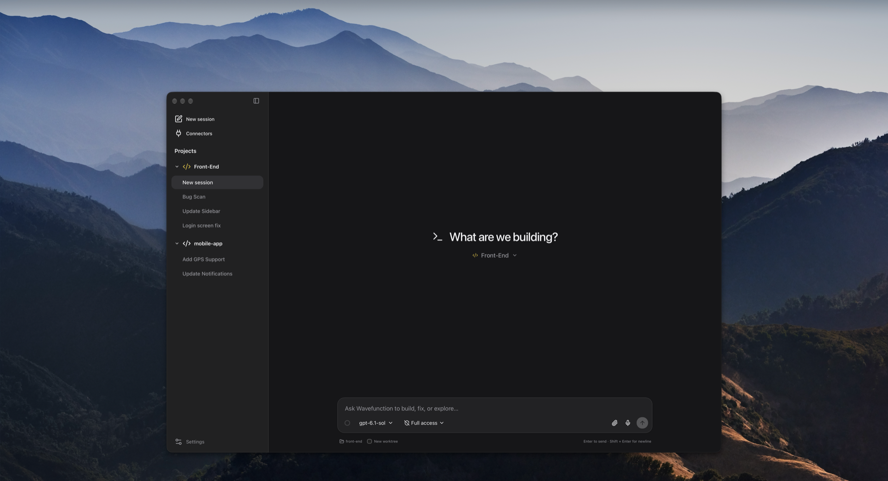
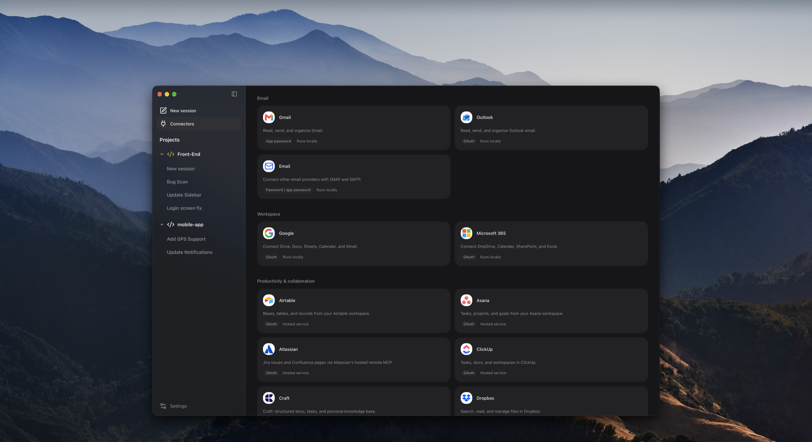
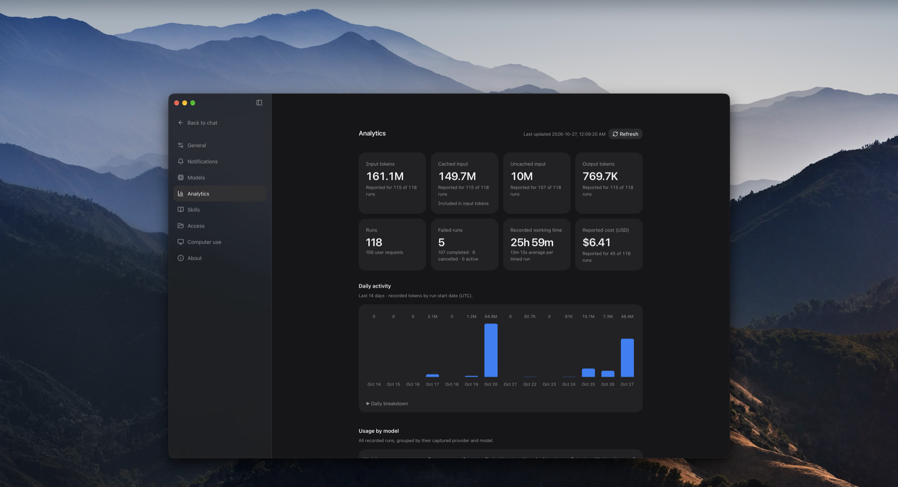
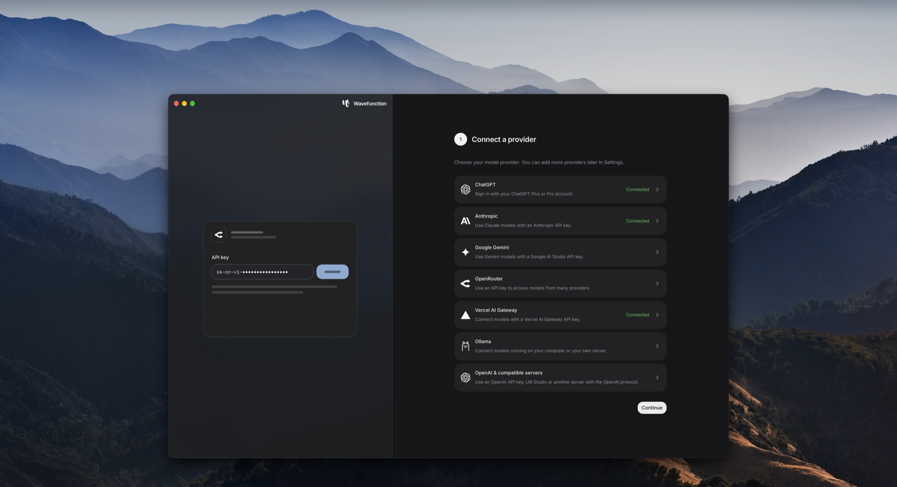
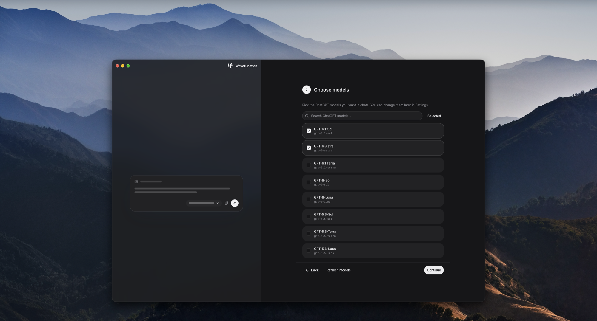

<p align="center">
  
</p>

<h1 align="center">Wavefunction</h1>

<p align="center">
  <strong>Minimal by design. Built to keep up.</strong><br>
  A fast, open-source coding agent for your Mac. Keep the conversation going while it works on several tasks at once.
</p>

<p align="center">
  <a href="https://github.com/stoyan-stoyanov/wavefunction/releases/latest">Download for macOS</a> ·
  <a href="#build-from-source">Build from source</a> ·
  <a href="CONTRIBUTING.md">Contribute</a>
</p>

<p align="center">Free and MIT licensed. Use local models, your own API keys or a ChatGPT sign-in.</p>



## Why Wavefunction

- **Less is more.** Coding agents are turning into super apps, adding more with every release. Wavefunction goes the other way: simpler is better, and building comes first.
- **Free to choose.** Pick any model and switch whenever you like. Run models locally or require zero data retention. You're never tied to one provider's plans or limits.
- **Open source, on the desktop.** Most open-source agents shine in the terminal. Wavefunction is built to be a great desktop app: minimal, considered and fast, and open source down to the prompt.

## Agents and sessions

Wavefunction has one built-in coding agent. Each chat is a separate conversation with it, with its own model, folder and history, and chats run side by side. A project is a folder, usually a Git repository, and groups the chats that work in it.

- **Worktrees.** In a Git repository a new chat starts on its own branch in its own checkout, so chats in one project don't step on each other. Untick **New worktree** before the first message to work in the project's folder instead.
- **Talk to it while it works.** A message sent during a task steers that task. **Queue follow-up** runs it after the task instead. When the agent needs a decision, it asks with a question card.
- **Helpers.** For bigger tasks the agent starts helpers: child chats that work in parallel and report back. They share the parent's checkout by default, or get an isolated worktree whose changes the parent reviews and brings in. Open one to read its transcript, redirect it or stop it.
- **Going back.** Fork a chat from any message, or rewind to put the code and the conversation back to how they were at that point.
- **Long conversations.** The ring in the message box shows how full the context is. Near the limit the conversation is summarised, keeping your requests and the confirmed state of the work. **Compact now** does it on demand.
- **Routines.** A chat can set up a routine: a chat that gets the same instruction on a schedule, such as every 15 minutes or weekdays at 9, while the app is open.
- **Projects from a chat.** Ask a chat to create a project (and clone a repository into it), archive old chats or remove a project.
- **Modes.** Plan mode reads and explains without changing anything. Full access runs commands outside the sandbox without asking each time; commands that can't be undone still ask.

## Computer use that leaves your Mac alone

Other agents take over your mouse, keyboard and screen to get things done. Wavefunction gets a desktop of its own, so you keep working while it clicks. Watch it, or take control at any time.

- **Your Mac stays yours.** It never moves your pointer, types on your keyboard or records your screen. Its desktop runs in a local Docker container that can reach the web, but not your files or keychain.
- **Secure sign-ins.** When a site needs your login, you sign in privately. The agent pauses and never sees what you type, and the chat stays signed in for next time.
- **Files in and out.** Downloads come to your Mac in the folder you choose, and files you add are ready to upload.

Computer use needs Docker Desktop and a model that can read images.

## Connectors and skills

70+ ready-made connectors, plus any MCP server you add. Wavefunction follows your `AGENTS.md` and loads `SKILL.md` skills from the `.agents/skills`, `.claude/skills` and `.opencode/skills` folders in your projects and home folder, and from `~/.codex/skills`, so it works with the setup you already use.



## Usage tracking

**Settings › Analytics** totals what every run used, from the numbers your providers report:

- input tokens, split into cached and uncached, and output tokens;
- runs, failed runs and working time;
- cost in US dollars, where the provider reports one;
- the last 14 days day by day, and totals per model.

When only some runs reported a figure, it says how many ("Reported for 12 of 15 runs") instead of counting the rest as zero.



## Secure and private

Use local models or require zero data retention. With **Require zero data retention** on in Settings → Models, OpenRouter and Vercel AI Gateway send chats only to providers that keep no prompts or responses. Other providers set it on your account with them.

- Your conversations, skills and settings stay on your Mac, in `~/Library/Application Support/app.harness.coding` (the app's identifier from before it was named Wavefunction, kept so existing data stays where it is). Provider and connector keys are local files only your user account can read; they are not encrypted.
- Commands run in the macOS sandbox by default, and folders outside your project need your grant. A command that needs to run outside the sandbox asks first, unless you've given that chat full access.
- A fixed check asks before commands it recognizes as irreversible, such as deletes or force pushes. It catches an overeager agent, not every case; see the [known issues](docs/KNOWN_ISSUES.md) and [SECURITY.md](SECURITY.md).

## Get started

Download the DMG from the [latest release](https://github.com/stoyan-stoyanov/wavefunction/releases/latest), open it and drag Wavefunction to Applications. It's signed and notarized by Apple, and it updates itself.

You need a Mac with Apple Silicon (macOS 11 or later). Setup walks you through connecting a provider, choosing models and creating your first project. Model usage is billed by your provider.

<p>
  
  
</p>

## Build from source

The app is a [Tauri](https://tauri.app) shell in Rust (`src-tauri`) around a React interface (`frontend`) and a Python agent engine (`backend`). The build freezes the engine with PyInstaller and bundles it, with its own Python, into the app.

You need macOS, Node.js 22+, [uv](https://docs.astral.sh/uv/) (it installs Python 3.12), Rust and the Xcode Command Line Tools.

```sh
npm run setup           # frontend packages and the Python environment, from their lockfiles
npm run desktop:build   # the engine, then the app
open src-tauri/target/release/bundle/macos/Wavefunction.app
```

`desktop:build` also writes a ZIP and its checksum to `dist/desktop`. Its signature is ad hoc, so the app runs on the Mac that built it but warns elsewhere. For a signed, notarized DMG you can hand to others, use `npm run release:local`, which needs a Developer ID certificate and an App Store Connect API key ([releasing](docs/RELEASING.md)).

While working on the interface, `npm run dev:fixture` runs it in your browser against a disposable synthetic workspace, with no account or model provider. `npm run desktop:dev` runs the app itself with the interface reloading as you edit. Before a pull request:

```sh
npm run check
```

[Development](docs/DEVELOPMENT.md) and the [architecture](docs/ARCHITECTURE.md) explain the rest.

## Contributing

Interested in contributing? We welcome new contributors. Start with [CONTRIBUTING.md](CONTRIBUTING.md) and the [code of conduct](CODE_OF_CONDUCT.md), and report security issues privately as described in [SECURITY.md](SECURITY.md).

## License

[MIT](LICENSE). Dependencies keep their own licenses; see [THIRD_PARTY_NOTICES.md](THIRD_PARTY_NOTICES.md).
